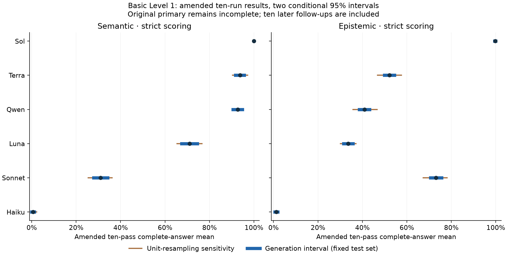

# Semantic and Epistemic Governance: Ten-Run Results on the Basic Level 1 Tests

Timothy O’Brien · [ORCID 0009-0001-2589-347X](https://orcid.org/0009-0001-2589-347X)

Preprint 0.2.0, 19 October 2026. Not peer reviewed. Independent researcher; no institutional affiliation. Copyright 2026 Timothy O’Brien. [CC BY 4.0](https://creativecommons.org/licenses/by/4.0/).

## Abstract

An ontology amendment can satisfy its visible goal while expanding a protected permission; an evidence review can reach a plausible conclusion from claims it is not authorized to use. We evaluate six hosted model configurations on this project’s basic Level 1 tests: 48 semantic development cases and 96 epistemic packets, with ten planned judgments per case. The reported dataset is explicitly post hoc amended: the original experiment supplied 8,630 of 8,640 planned responses, and ten later fresh generations filled its unknown-outcome slots without replacing any received answer. The incomplete original cohort and all unknown attempts remain preserved separately. Under strict typed bare-JSON scoring, amended ten-pass means range from 0.625 to 100.000 percent for semantic tasks and from 1.250 to 99.792 percent for epistemic tasks. Sole-outer-fence sensitivity changes some results substantially, including Haiku epistemic correctness from 1.250 to 72.917 percent, so formatting failures are separated from completed task errors. We report every round, round variation, per-case consistency, generation intervals for the fixed test set and separate unit-resampling intervals. The 48 semantic cases form twelve construction groups; the 96 epistemic packets are eight views of each of twelve units. Repeated generations add no independent task units. These are descriptive measurements on inspected development material, conditional on the supplied governance contracts, provider behavior and later follow-up timing. They do not establish held-out generalization, real-source trust, equal compute or autonomous-agent containment.

## Introduction

A reviewer of an ontology change must answer two different questions: what does the change do, and what does the available evidence warrant concluding about it? We call the first obligation semantic governance and the second epistemic governance. An intermediate classification edge can grant a protected permission without changing its permission rule. An apparently corroborated safety report can instead lack claim-specific authority, be stale, or share its original evidence with another report.

This paper evaluates model answers to fixed finite tasks about those obligations. Semantic calls judge a supplied batch of changes against explicit goals and protected permissions. Epistemic calls apply supplied authority, provenance, conflict and observation rules to a structured evidence packet. Neither track performs an actual release or measures an autonomous agent acting in an external system. A reference checker determines correctness within the declared abstraction; it does not authenticate real sources or establish that an organization’s policy is adequate.

The empirical contribution is a six-configuration, ten-round repeatability measurement on an already inspected development test set. We retain every received response, distinguish complete answers from their components, and report both strict formatting and a narrowly defined framing sensitivity. The main reported dataset includes ten separately authorized later generations for unknown original outcomes. It is an explicitly amended descriptive analysis, not an uninterrupted complete original experiment or an evaluation on new held-out cases.

The paper contributes the fixed executable test set and alternative-solution-aware references, all ten round measurements and case-consistency summaries, and an offline-replayable record of the original incomplete cohort and its separate amendment. The original single-pass study, eleven-model correction study and two-model source-evidence study are supporting historical cohorts; none supplies observations to the ten-round numerator or denominator.

## Related work

Ontology policies, policy change analysis and consequence preservation are established topics. KAoS and Margrave analyze formal policies; logical difference and conservative extension compare ontology consequences across versions \[1, 2, 3, 4\]. Our finite exhaustive reference applies established principles to supplied batches of ontology changes rather than introducing a new preservation theorem.

External enforcement also predates this study. Ontology-to-tools compilation and PCAS connect formal policy to executable interfaces, while CaMeL and MemLineage separate trusted control or provenance from untrusted content \[5, 6, 17, 18\]. Authorization Closure Graph represents changing instructions as versioned authorization state, while Authority at Commit Time rechecks proposal dependencies before admission \[10, 12\]. Governed Deduction studies transition-local premise authorization, and the Pentad research note argues for externally checked and enforced ontology contracts \[11, 13\]. We evaluate model recommendations against an explicit contract; we do not demonstrate a deployed reference monitor or general agent containment.

Context sufficiency, abstention and conflicting memory are established evaluation concerns \[14, 15, 16\]. Repair-based reasoning supplies ways to preserve consistent alternatives when evidence conflicts; provenance and epistemic-cue studies further limit broad novelty claims \[19, 20, 21\]. Here the contribution is an executable connection between those concerns and ontology-amendment review, including source admission, permission effects, legitimate alternative interpretations and follow-up checks.

Neurosymbolic deduction and tool-assisted correction have substantial prior art \[7, 8\]. The ten-round experiment supplies neither correction feedback nor reference facts to evaluation models. Unlike preference-based LLM judging \[9\], its answers are checked against separately reconstructed finite references. The objective is a transparent diagnostic study, not a new general theory of governance.

## Task contracts and constructed tests

The full constructed material contains 96 semantic cases (48 TRAIN, 48 DEV) and 144 epistemic packets (48 TRAIN, 96 DEV). Only the fixed 48 semantic DEV cases and 96 epistemic DEV packets enter each ten-round pass. Six TRAIN interface observations per model belong to the separate historical single-pass study; no new interface calls enter the ten-round results. No held-out TEST set was sampled for this study.

The semantic DEV cases form twelve construction groups: six groups have six cases and six have two. The epistemic DEV packets arise from twelve underlying units, each with four authority/provenance conditions and two presentation orders. There are 224 action decisions per epistemic pass, but neither those actions nor the matched views are independent tasks. Ten repetitions preserve the same twelve groups or units; they do not create 480 independent semantic systems or 960 independent epistemic systems per model.

### What an ontology change may and may not do

An ontology is a set of classifications and rules. A rule such as “A implies B” lets the checker derive B from A. A conjunction requires all its inputs, such as “A and B imply C.” A starting profile lists the input properties initially present. Helper classifications must be reached through the rules rather than asserted as starting facts.

The review contract fixes the vocabulary, starting profiles, requested goals, protected permissions and task scope. A candidate is a supplied batch of rule or classification changes. The model judges that entire batch; it is not restricted to proposing one edge. The candidate must pass every requested positive and negative check. A negative check asks whether a classification is absent from the derived facts, rather than asserting a new logical negation.

Conflicting classifications have an explicit operational consequence. The checker retains the facts it has derived, but grants no effective permissions to a profile containing a forbidden pair. Removing a conflict can therefore create effective access even if the permission was already present among the raw derived facts. A contradiction does not make every statement true in this implementation.

A protected permission expands when at least one permitted starting profile gains it after the batch. Every expansion needs its own applicable approval. A registry record must match the original and candidate versions, contract, task scope, permission, semantics and policy; fragments of different records cannot be combined into an approval. A change may be released only when every goal passes and every protected expansion has a matching approval. Approval cannot repair a failed goal. Model recommendations do not themselves perform a release.

### Larger semantic amendments

The full constructed semantic task collection contains 96 cases, divided equally between training and development, with three size levels (Table 1). It asks the model to judge a group of edits together. Some groups create a new permission even though no individual edit does; others add one protected permission while leaving another unchanged. Other cases remove a conflict, preserve a blocking conflict, or achieve one requested goal while failing another. The checker tests each edit separately as well as the complete group to identify these interactions. If an edit cannot be applied by itself, that diagnostic is marked unavailable rather than counted as harmless. Approval is checked separately for every protected permission.

| Property                     | Tier 1 | Tier 2 | Tier 3 |
|:-----------------------------|-------:|-------:|-------:|
| Semantic classes             |     32 |     64 |     96 |
| Public seed classes          |      8 |     10 |     12 |
| Profiles checked per version |    256 |  1,024 |  4,096 |
| Edits per batch              |    2–3 |    3–4 |    4–5 |
| Protected permissions        |      2 |      3 |      4 |
| Epistemic Boolean atoms      |      8 |     10 |     12 |
| Reports per packet           |  29–33 |  35–39 |  47–53 |
| Separate release decisions   |      2 |      2 |      3 |

Constructed task complexity, not model scores. Each tier contains 32 semantic cases (16 TRAIN, 16 DEV) and 48 epistemic packets (16 TRAIN, 32 DEV).

Two separately implemented algorithms agree on all 172,032 before-and-after profile comparisons. One applies rules to sets of facts; the other computes results for many profiles together using bitsets. They compare every declared classification, permission and consistency result. The model must identify each protected permission that expands and give a starting profile demonstrating the gain. Any valid example receives credit; it need not be the first or smallest one found by the checker. The comparison remains limited to the declared input vocabulary.

### Competing evidence and multiple valid answers

The full constructed epistemic artifact contains 144 packets from 18 units. Each unit has four matched authority/provenance conditions and two presentation orders. Within each unit, a single grant revocation and specified provenance-parent changes form a two-by-two intervention. Claim content and identifiers stay fixed. Six units are training material and twelve are development; no held-out test units have been sampled.

In the epistemic task, permission to report is checked for each fact and each amendment under review. A source can therefore be authorized for one claim but not another, or current for one amendment but stale for another. Reports also identify the earlier observations they rely on. Following these links produces a provenance graph: a record of where the information came from.

To establish a fact, this version requires two or three eligible reports whose original observations do not overlap. Different speakers are not enough. Two apparently separate reports may share part of their evidence and therefore fail the independence requirement. The broker supplies these relationships and authentication facts; the model must apply them correctly.

The evidence policy handles a disagreement without automatically discarding everything else in the packet. It keeps every consistent selection of supported facts to which no further supported fact can be added without breaking the fixed constraints. Such a selection is called a *repair*. “Maximal” means nothing more can be added consistently; it does not mean choosing the selection containing the most facts. Claims are considered separately, so different statements in one report can receive different treatment.

For each repair, the checker considers every possible value of the facts it leaves unsettled, subject to the packet’s fixed constraints. Release is justified only if all those possibilities, across all repairs, allow it. Denial is justified only if all deny it. Otherwise the answer is undetermined. The model may return any valid repair as an example, but it must consider the alternatives when deciding whether release is justified.

For example, equally authorized and independently corroborated sources can disagree about a required goal. Either consistent evidence interpretation may be valid, while approval remains unestablished across them. An unrelated disagreement need not erase a decisive failed goal for another release. The implemented task collection has multiple valid repairs in 136 of 144 packets, including cases with incomparable repairs of different sizes. This is controlled ambiguity under explicit rules, not permission to approve or deny arbitrarily.

### A small example with two valid evidence interpretations

The following four-fact example illustrates the evidence policy. It is not one of the 144 generated packets and has not been sent to a model. Its answers are checked by both reference implementations. To keep the illustration small, one current authorized report is enough to support a claim; the generated development packets require two or three independent reports. Disagreements are handled through alternative consistent interpretations.

Suppose a proposal is being reviewed for two requested tasks, A and B. Both reviews depend on the same question about protected permission. An authorized report states that task A’s goal passed, task B’s goal failed, no exact approval exists, and the proposal creates no new protected permission. A second equally authorized report supplies one observation: it says the proposal *does* create a new protected permission. Both reports are current. Neither source has priority over the other.

Only the permission claim is disputed. The three undisputed facts remain usable in either interpretation. Table 2 shows the two complete consistent choices. Both receive full credit as an evidence interpretation. Choosing the favorable one, however, does not establish that task A may proceed: the other valid interpretation reaches the opposite conclusion. Task B must be denied in either interpretation because its goal failed.

| Evidence interpretation                        |    Task A    | Task B |
|:-----------------------------------------------|:------------:|:------:|
| Keep the claim that permission does not expand |    Allow     |  Deny  |
| Keep the claim that permission expands         |     Deny     |  Deny  |
| Conclusion justified across both               | Undetermined |  Deny  |

Two valid interpretations in the illustrative development example. A failed goal remains decisive despite the separate permission dispute.

The next useful check is to establish whether permission actually expands. That settles task A while task B remains denied. Rechecking approval would repeat an already settled fact. In the verified illustration, checking expansion costs one unit, checking approval costs one, and checking both costs two. The reference therefore selects the expansion check: it resolves the remaining decision at the lower cost. This example tests three separate abilities—retaining undisputed evidence, recognizing legitimate alternatives, and choosing a useful follow-up—without requiring the model to invent a credibility ranking.

### Choosing the next observation and measuring shortcuts

The model is also asked what it should check next. The packet offers a menu of reliable follow-up checks, each with a stated cost. To compare them, the checker considers every answer a check could return under the current evidence. After each possible answer, it counts how many release decisions would still be unresolved. A check is judged by its least helpful possible outcome: the largest remaining count. The preferred check has the lowest such count; when counts tie, the lower cost wins. Any check tied on both receives credit.

These hypothetical observations narrow the existing set of possibilities; they do not rebuild the evidence interpretations. This is a one-step choice about the next useful observation. It does not assume probabilities for the alternatives or find the cheapest complete investigation.

Two separately written checkers agree on all 144 packets. One starts from possible consistent selections of evidence; the other starts from possible assignments of true and false to the facts. Rule baselines over all 144 constructed packets (TRAIN and DEV together) illustrate why separate scores matter: always-undetermined and blanket conflict quarantine each correctly classify 124 of 336 action decisions (36.9%); choosing one arbitrary repair yields 260/336 (77.4%); and treating reports as independent yields 268/336 (79.8%). These are deterministic ablations, not measured LLM results. Packets share units and presentation twins, so these action counts are descriptive and not independent trials.

The scorer separates supported facts, valid repair certificates, warranted decisions, possible outcomes and optimal-query membership. The ten-round results report whole-packet components; historical per-action and matched-pair summaries are not silently reused as repeated measurements. The ten-round protocol froze these cases, request bodies, parser and provider settings before its original launch; later execution and missing-outcome amendments are disclosed below. Fresh test units and held-out mechanism combinations remain future work. A consistent lie from an authorized, sufficiently corroborated source remains outside what this evidence contract alone can detect.

## Model calls and answer scoring

### Inputs and inference settings

Every call has a system message and one user message. There is no preceding conversation or earlier answer. The semantic system message states how to apply all changes, derive consequences, check conflicts, compare protected permissions and match approvals. Its user message is a structured JSON packet containing the contract and base ontology, requested goals, proposed batch, trusted approval registry and current version bindings. Construction-family names, reference answers and checker witnesses are withheld.

The epistemic system message says that source payloads cannot change the immutable policy and that the answer performs no actual release. The user message gives the complete evidence rules followed by a JSON packet of Boolean claims, authority grants, current versions, reports, provenance links, consistency constraints, proposed actions and offered follow-up queries with costs. The model receives the evidence it must assess, not the reference’s supported facts, selected repairs or possible worlds. Source identity, authentication and provenance are supplied simulator facts rather than discoveries the model makes about real systems.

The semantic output contains goal correctness, the complete set of expanding permissions, approval and authorization maps, release eligibility and one valid example profile for each expansion. The epistemic output contains supported facts, one valid consistent interpretation, the warranted decision for each action, all possible release outcomes, and the next query or an explicit null. A response may use any valid witness or repair and any tied optimal query. The fixed decision rule still determines whether each action is allowed, denied or undetermined. Literal instructions for these current tasks appear in Appendix D.

All six configurations use pinned OpenRouter model identifiers and providers, with fallback disabled, requested native medium reasoning and a 32,768 combined reasoning/output-token allowance. “Medium” is an API setting, not a measured amount of reasoning or equal compute across services. Qwen uses temperature zero; the OpenAI and Anthropic endpoints omit temperature. No common generation seed is imposed. Analysis bootstrap seeds are unrelated to model sampling seeds. JSON is requested by the prompt; there is no API response-format constraint.

| Short name | Model identifier              | Pinned provider |
|:-----------|:------------------------------|:----------------|
| Sol        | `openai/gpt-6.1-sol`          | OpenAI          |
| Terra      | `openai/gpt-5.6-terra`        | OpenAI          |
| Qwen       | `qwen/qwen3.8-27b`            | Chutes FP8      |
| Luna       | `openai/gpt-6-luna`           | OpenAI          |
| Sonnet     | `anthropic/claude-sonnet-5.5` | Anthropic       |
| Haiku      | `anthropic/claude-haiku-5.5`  | Anthropic       |

All six recorded configurations: requested medium native reasoning and a 32,768 combined-token allowance. Short names identify these hosted configurations, not fixed model weights or an equal-compute condition.

### Scoring and observed versus missing outcomes

The primary scoring rule requires one bare JSON object with the complete typed schema and the declared list-order requirements. The separate sensitivity removes only a sole outer code fence; it does not extract JSON from prose, reorder epistemic facts, repair an object or select a better answer. Witnesses, repairs and next observations accept every semantically valid or tied-optimal answer under the original scorer.

Complete semantic correctness requires all fields, including every protected expansion and valid witness. Complete epistemic correctness requires supported facts, a valid repair, all decisions, all possibilities and an optimal next query. Component scores count whole answers correct for that field; “all decisions correct” is not per-action accuracy. A valid undetermined answer is a substantive decision, not a missing response.

A delivered malformed, schema-invalid, filtered, length-limited or provider-error response remains an observed outcome under the declared scoring rule. An unresolved transport outcome has no invented final answer: it remains missing in the original cohort. Complete ten-pass means, per-case out-of-ten counts and resampling intervals are unavailable for an incomplete model-track. The later missing-outcome follow-ups form a separate amended view rather than changing that rule retrospectively.

Native bodies, final extraction, usage, categories and scores were checked against frozen cases and sources before reporting. Separately implemented references agree on the stated finite comparisons. This is implementation agreement and artifact replay, not independent validation of the task policy, real-source truth or a provider’s internal model weights.

## Ten-round design, execution amendments and estimands

### Original design and later follow-up

The original ten-round plan contained 6 configurations times 10 passes times (48 semantic plus 96 epistemic DEV inputs), or 8,640 slots. A slot identifies a model, case and nominal pass. Every call is a fresh full-task judgment with no preceding answer, checker feedback, reflection or component assistance. The test set had already been inspected during development and the earlier single-pass study; fresh generations do not make it a new held-out evaluation.

The author amended dispatch from shared pass barriers to independent model queues, retaining original within-model pass/case order, at most four concurrent requests per model and 24 overall. Three later execution legs admitted exact never-submitted complements after interruptions, retaining earlier responses and unknowns. Across the original four legs, 8,630 finals were received, ten attempted outcomes remained unknown and no original slot remained never submitted. The unknown boundaries were eight IncompleteRead and two URLError events without client finals; their causes are unestablished. Three explicit transient HTTP failures (one 504 and two 502) received permitted identical retries. No delivered incorrect answer was correctness-retried.

After the original cohort closed, the author separately authorized one fresh generation for each of its ten unknown slots: four Qwen requests (one semantic, three epistemic) and two epistemic requests each for Terra, Luna and Haiku. These requests used new follow-up identities and identical original bodies/settings/scorers. All ten delivered without a new transport loss or transient retry. The original ten unknown attempts, full failed/unknown reservations and all 8,630 earlier finals remain unchanged. The post-hoc amended dataset therefore has 8,640 observed finals and twelve complete model-tracks; the original primary study remains incomplete.

| Execution | Received finals | New unknowns | Transient failures | Closed attempts |
|:---|---:|---:|---:|---:|
| Original | 765 | 0 | 1 | 766 |
| Queue continuation | 451 | 6 | 0 | 457 |
| Never-submitted recovery | 6,672 | 4 | 2 | 6,678 |
| Final never-submitted leg | 742 | 0 | 0 | 742 |
| Unknown-outcome follow-up | 10 | 0 | 0 | 10 |

Execution history. The first four legs comprise the incomplete original primary cohort; the final row is a separately authorized post-hoc missing-outcome follow-up. Failed attempts and unknowns are retained, not counted as received task answers.

Original dispatch began on 18 October 2026; its fourth leg ended at 15:20 UTC on 19 October. The ten follow-ups were submitted at about 16:02 UTC and all returned before 16:06 UTC that day. Nominal passes are bookkeeping labels, not synchronized independent experimental blocks. Later follow-ups retain the missing slots’ pass labels: one semantic and three epistemic Qwen slots in pass 5, plus six epistemic slots in pass 2 for Terra, Luna and Haiku. Their measurements were not made at the original pass time. Exact submission/completion times remain in the supplement.

### Separate uncertainty questions

For each complete model-track/parser combination, let $Y_{cr}$ be complete-answer correctness for fixed DEV case $c$ and nominal pass $r$. We report all ten pass rates, their mean, sample standard deviation (denominator nine), range, and each case’s success count out of ten. Because all amended passes have equal case counts, the mean equals the pooled correct count divided by 480 semantic or 960 epistemic observations. This equality is not used to repair an incomplete original denominator.

A within-case generation bootstrap for the fixed test set resamples ten observed correctness values with replacement within each fixed case and averages them, with 20,000 draws and seed 2026101803. Its percentile interval describes resampling variation conditional on these exact cases. It assumes within-case generation exchangeability and resamples cases’ generations separately; shared load, provider drift and the later follow-ups can violate that assumption and understate uncertainty. An all-success empirical sample produces a degenerate interval, not a proof of perfect reliability.

A separate unit-resampling sensitivity samples the twelve underlying construction groups or units with replacement, retaining every matched view and all ten observations of each selected unit (20,000 draws, seed 2026101804). The case-weighted estimand weights semantic groups of six more than groups of two; the unit-weighted estimand gives each group equal weight. Both are supplied. These conditional construction sensitivities are not interchangeable with generation variation and are not population guarantees for unseen tasks.

Fifteen within-track paired configuration contrasts per parser (60 across both tracks and parsers) use the same sampled units across configurations and are explicitly exploratory. No significance-selected headline, multiple-comparison discovery or shared generation-seed pairing is claimed. The frozen statistical algorithms and seeds are unchanged in the amended analysis. All numerical results below refer to that amended dataset unless labeled original or historical.

## Amended ten-round results

### Complete answers and pass variation

Table 5 reports every configuration and both tracks. The display order is the fixed configuration order, not a pooled leaderboard. The strict scoring rule is primary; sole-fence values are a separately labeled sensitivity. All six configurations supplied 480 semantic and 960 epistemic finals in the amended view. No historical interface, single-pass or correction observation enters these counts.

| Config. | Track | Strict correct | Strict mean |    SD |      Pass range | Fence mean |
|:--------|------:|---------------:|------------:|------:|----------------:|-----------:|
| Sol     |     S |        480/480 |     100.000 | 0.000 | 100.000–100.000 |    100.000 |
| Sol     |     E |        958/960 |      99.792 | 0.439 |  98.958–100.000 |     99.792 |
| Terra   |     S |        450/480 |      93.750 | 2.406 |   89.583–97.917 |     93.750 |
| Terra   |     E |        501/960 |      52.188 | 4.539 |   45.833–59.375 |     52.188 |
| Qwen    |     S |        445/480 |      92.708 | 2.250 |   89.583–95.833 |     96.667 |
| Qwen    |     E |        393/960 |      40.938 | 5.358 |   34.375–50.000 |     43.750 |
| Luna    |     S |        341/480 |      71.042 | 8.531 |   56.250–85.417 |     71.042 |
| Luna    |     E |        323/960 |      33.646 | 2.506 |   29.167–37.500 |     33.646 |
| Sonnet  |     S |        149/480 |      31.042 | 3.860 |   27.083–39.583 |     31.042 |
| Sonnet  |     E |        702/960 |      73.125 | 4.331 |   62.500–78.125 |     88.229 |
| Haiku   |     S |          3/480 |       0.625 | 1.006 |     0.000–2.083 |     49.167 |
| Haiku   |     E |         12/960 |       1.250 | 1.076 |     0.000–3.125 |     72.917 |

Post-hoc amended complete-answer results. S=semantic, E=epistemic. Mean and range are percentages; sample SD is percentage points across ten nominal passes. Sole-fence scoring changes only a sole outer code fence. All settings: medium native reasoning, 32,768 combined tokens.

Qwen’s strict means are 92.708 percent semantic (445/480) and 40.938 percent epistemic (393/960); sole-fence means are 96.667 and 43.750 percent. Terra’s corresponding strict means are 93.750 and 52.188 percent. These are different task contracts on different constructed inputs, so the gap is descriptive rather than an isolated causal effect of “epistemic reasoning.” Sol has 480/480 strict semantic and 958/960 epistemic complete answers. Its near-ceiling result limits claims that this fixed test set is a frontier difficulty benchmark.

All ten pass rates under both parsers appear in Appendix A. They are not ten independent new-case studies. The full supplement additionally retains per-case out-of-ten counts, their distributions, both estimands, all exploratory contrasts and native completion times. The highest strict semantic pass SD is Luna’s 8.531 percentage points; an average alone would hide that variation.

| Config. | Track | Generation interval | Unit sensitivity | Equal-unit mean |
|:--------|------:|--------------------:|-----------------:|----------------:|
| Sol     |     S |     100.000–100.000 |  100.000–100.000 |         100.000 |
| Sol     |     E |      99.479–100.000 |   99.375–100.000 |          99.792 |
| Terra   |     S |       91.667–95.625 |    90.417–97.143 |          95.000 |
| Terra   |     E |       49.896–54.479 |    46.771–57.604 |          52.188 |
| Qwen    |     S |       90.625–94.792 |    90.208–95.000 |          93.472 |
| Qwen    |     E |       38.646–43.229 |    35.833–46.667 |          40.938 |
| Luna    |     S |       67.500–74.583 |    65.417–76.667 |          71.250 |
| Luna    |     E |       31.562–35.833 |    30.104–37.083 |          33.646 |
| Sonnet  |     S |       27.917–34.167 |    25.455–36.167 |          30.139 |
| Sonnet  |     E |       70.625–75.625 |    67.396–78.125 |          73.125 |
| Haiku   |     S |         0.000–1.250 |      0.000–2.250 |           1.250 |
| Haiku   |     E |         0.625–1.979 |      0.521–2.083 |           1.250 |

Strict complete-answer summaries: two distinct conditional 95% percentile intervals, in percent. Unit interval is case-weighted; the last column is the separately defined equal-unit mean. Equal-unit intervals and both-parser summaries are supplied in the supplement. These are not unseen-task reliability bounds.

<figure>

<figcaption>Strict complete-answer means (points), generation intervals for the fixed test set (thick blue) and separate unit-resampling sensitivities (thin orange). All include the ten post-hoc follow-ups; the original study remains incomplete. These conditional intervals address different questions.</figcaption>
</figure>

### Components, formatting and native boundaries

The semantic components require goals, expansion sets, witnesses, exact approvals, per-permission authorization and release decisions. The epistemic components require supported facts, a valid repair, all warranted decisions, all possible outcomes and an optimal observation. Component counts in Appendix B use the full amended denominator under both parsers. They describe the model’s original full-task answer, not performance after supplying verified intermediate facts.

For example, Terra gives every epistemic action decision correctly in 839/960 strict whole-packet answers, but only 501/960 answers are completely correct. Qwen’s corresponding counts are 679/960 and 393/960. A correct decision can coexist with an incomplete support set, invalid repair or inferior next observation. These packet-level counts must not be read as per-action rates or as evidence of successful external enforcement.

Format effects are substantial. Haiku’s strict semantic result is 3/480, versus 236/480 with sole-fence normalization; its epistemic result changes from 12/960 to 700/960. Sonnet’s epistemic result changes from 702/960 to 847/960, while its semantic result stays 149/480 because 329 finals remain unparseable under either parser. These differences are sensitivity to the answer contract, not demonstrated improvements in the underlying reasoning process. Unparseable prose cannot be assumed logically wrong or silently converted into a valid answer.

| Config. | Track | Parser | Correct | Error | Parse | Schema |
|:--------|------:|-------:|--------:|------:|------:|-------:|
| Sol     |     S | strict |     480 |     0 |     0 |      0 |
| Sol     |     S |  fence |     480 |     0 |     0 |      0 |
| Sol     |     E | strict |     958 |     2 |     0 |      0 |
| Sol     |     E |  fence |     958 |     2 |     0 |      0 |
| Terra   |     S | strict |     450 |    30 |     0 |      0 |
| Terra   |     S |  fence |     450 |    30 |     0 |      0 |
| Terra   |     E | strict |     501 |   459 |     0 |      0 |
| Terra   |     E |  fence |     501 |   459 |     0 |      0 |
| Qwen    |     S | strict |     445 |    15 |    20 |      0 |
| Qwen    |     S |  fence |     464 |    16 |     0 |      0 |
| Qwen    |     E | strict |     393 |   510 |    57 |      0 |
| Qwen    |     E |  fence |     420 |   540 |     0 |      0 |
| Luna    |     S | strict |     341 |   139 |     0 |      0 |
| Luna    |     S |  fence |     341 |   139 |     0 |      0 |
| Luna    |     E | strict |     323 |   636 |     0 |      1 |
| Luna    |     E |  fence |     323 |   636 |     0 |      1 |
| Sonnet  |     S | strict |     149 |     2 |   329 |      0 |
| Sonnet  |     S |  fence |     149 |     2 |   329 |      0 |
| Sonnet  |     E | strict |     702 |    88 |   166 |      4 |
| Sonnet  |     E |  fence |     847 |   107 |     0 |      6 |
| Haiku   |     S | strict |       3 |     0 |   477 |      0 |
| Haiku   |     S |  fence |     236 |     2 |   242 |      0 |
| Haiku   |     E | strict |      12 |     5 |   943 |      0 |
| Haiku   |     E |  fence |     700 |   258 |     0 |      2 |

Mutually exclusive amended outcome categories. S rows sum to 480; E rows to 960. Error means a parsed, schema-valid completed task error; Parse and Schema are distinct. Every received final had native stop status; there were no received length/filter/provider-error finishes. Original unresolved transport attempts remain outside these delivered-response rows.

Luna has one schema-invalid epistemic final. Sonnet has four strict and six sole-fence schema-invalid epistemic finals; removing a fence can expose a previously unparsed schema defect. Haiku retains two schema-invalid epistemic finals under the sensitivity. All 8,640 delivered responses have native stop finishes; the historical single-pass Haiku overload is not a ten-round provider failure. Transport unknowns, final-format defects and completed task errors therefore require separate accounting.

### Resources and original incomplete-cohort sensitivity

Equal request counts, effort labels and token caps do not establish equal realized reasoning, cost or elapsed time. Native usage, latency and dispatch metadata are retained by model and track. Reported complete charges across all legs are USD 134.006024705. Full failed/unknown attempt reservations remain USD 1.947109186, giving exposure USD 135.953133891 under the unchanged USD 200 global ceiling. The ten follow-ups added USD 0.167018389 in reported complete charges. Reservations are protective upper bounds, not asserted actual billing, and no cap increase was applied.

The original primary cohort is supplied separately, with 8,630 received finals, ten unknown outcomes and no never-submitted slots. Its Qwen semantic and epistemic tracks have 479/480 and 957/960 received; Terra, Luna and Haiku each have 958/960 epistemic. These five original model-tracks retain unavailable full-ten means, sample SDs, ranges, per-case out-of-ten summaries and resampling intervals. Seven original model-tracks were complete and their results are unchanged by the amendment. Table 8 makes the two views explicit rather than estimating full-ten statistics from a favorable observed subset.

| Config. | Track | Received/planned | Unknown | Full-ten mean |
|:--------|------:|-----------------:|--------:|--------------:|
| Sol     |     S |          480/480 |       0 |       100.000 |
| Sol     |     E |          960/960 |       0 |        99.792 |
| Terra   |     S |          480/480 |       0 |        93.750 |
| Terra   |     E |          958/960 |       2 |   Unavailable |
| Qwen    |     S |          479/480 |       1 |   Unavailable |
| Qwen    |     E |          957/960 |       3 |   Unavailable |
| Luna    |     S |          480/480 |       0 |        71.042 |
| Luna    |     E |          958/960 |       2 |   Unavailable |
| Sonnet  |     S |          480/480 |       0 |        31.042 |
| Sonnet  |     E |          960/960 |       0 |        73.125 |
| Haiku   |     S |          480/480 |       0 |         0.625 |
| Haiku   |     E |          958/960 |       2 |   Unavailable |

Immutable original primary cohort before unknown-outcome follow-ups. Full-ten strict means (percent) remain unavailable for all five incomplete tracks. Later responses appear only in the separately labeled amended dataset.

## Discussion and limitations

### What the measurements establish

The recorded configurations differ descriptively across the two fixed task contracts. The repeated cohort confirms that a single first judgment can hide generation variation: pass distributions and per-case consistency complement a mean. It also confirms that strict serialization and task content are different failure boundaries. All-model, both-parser reporting prevents a code-fence sensitivity from being presented as a reasoning improvement or a parsed decision from standing in for a complete evidence analysis.

The semantic and epistemic tasks are not matched interventions isolating one cognitive property. They differ in input structure, output length, reference computation and failure opportunities. Their contrast motivates separate obligations and diagnostics; it does not identify a causal explanation of model differences. “Basic Level 1” identifies the initial test stage in this project. The harder Level 2 tests are outside this paper’s scope. This stage label is not a calibrated universal difficulty scale or a claim that all models find these tests easy. Sol’s semantic ceiling is evidence about these cases, not a proof of universal governance competence.

### What repeated generations do not establish

All material is inspected DEV data from a development program that preceded this repetition. New generations do not erase family selection or exposure. Twelve construction groups or units limit inference even when thousands of responses are retained. A prospective study on sealed new units and held-out mechanism combinations would address generalization; this study does not.

The original experiment was interrupted, its scheduling changed, and the ten unknown-outcome follow-ups occurred later. Selection on missingness, provider drift, shared load and unobserved transport causes may violate exchangeability. Retaining every known answer and following up all ten missing slots avoids correctness selection among received answers; it does not prove that missingness was random. The amended intervals are descriptive conditional summaries, and the incomplete original record remains necessary to assess that choice.

The finite semantic reference covers only the declared starting vocabulary and protected queries. The epistemic reference applies stipulated authority, identity, provenance and consistency rules; disjoint origin leaves are a policy criterion, not proof of statistical independence or source truth. A consistent falsehood from eligible corroborated sources can be undetectable. Neither reference identifies the correct institutional policy. No model recommendation carries out an operation, so there is no demonstrated autonomous-agent containment, practical authorization security, real injection success rate or legality guarantee.

Native reconstruction and exact offline replay make artifacts inspectable. Shared specification errors can still affect both reference implementations; replaying saved finals does not independently regenerate them, authenticate a hosted model’s internals or constitute external scientific peer review. No feedback effectiveness or causal effort benefit is estimated by the ten-round cohort. The separate historical assisted studies retain their own stronger information and stopping conditions.

## Conclusion

The completed post-hoc amended dataset supplies all 8,640 planned slot responses for six configurations across ten nominal passes. Its complete-answer, pass-variation, per-case and component results distinguish consequences of ontology changes from warranted evidence use, while exposing substantial serialization effects. The preserved original 8,630-response cohort and ten unknown attempts make the later amendment auditable.

The defensible contribution is an executable diagnostic study on a fixed inspected development test set, with explicit alternative-answer rules and reproducible conditional summaries. It supports neither a pooled reliability ranking nor an uninterrupted-original-completion or security claim. Future sealed-unit evaluation is needed to test behavior beyond these constructions.

## Data and code availability

The existing [Level1 repository](https://github.com/prosessleder/semantic-epistemic-governance-level1) supplies the original fixed test set and historical results. The [version 0.2.0 preprint supplement](https://github.com/prosessleder/semantic-epistemic-governance-level1/releases/tag/v0.2.0-preprint) adds the original incomplete and separately amended ten-round final projections, exact scorers/cases, attempt/usage metadata, both full analyses and offline replay. This supplement accompanies the public preprint. In the new ten-round projection, host-specific operational paths and private author/planning records are excluded, with explicit metadata-redaction provenance. Scientific cases, scores, finals, usage and statistical algorithms remain unchanged. Full native HTTP, reasoning and partial/error bodies remain in the private research archive.

## Author contributions and AI assistance

Timothy O’Brien is the sole author and conducted the work independently, without institutional affiliation. OpenAI Codex assisted literature discovery, implementation, experimental orchestration, artifact auditing, adversarial manuscript review and drafting. Evaluation responses were collected in separate API calls; Codex assisted the research workflow. AI-assisted checking is not independent external peer review; specification, interpretation, references and publication accountability remain with the author.

## Funding

This research received no external funding.

## Competing interests

The author declares no competing interests.

## All ten nominal pass results

Each entry is complete-answer percentage for all 48 semantic or 96 epistemic DEV inputs in that nominal pass, with no interface or historical observations. Strict and sole-fence tables are separate. Pass labels do not denote synchronized time blocks. The amended semantic pass 5 contains one later Qwen generation; epistemic pass 2 contains two later generations each for Terra, Luna and Haiku, and epistemic pass 5 contains three later Qwen generations. All other cells retain their original received finals. Complete counts, exact times and original/follow-up identifiers are retained in the supplement.

| Pass |     Sol |  Terra |   Qwen |   Luna | Sonnet | Haiku |
|:-----|--------:|-------:|-------:|-------:|-------:|------:|
| 1    | 100.000 | 95.833 | 89.583 | 66.667 | 31.250 | 0.000 |
| 2    | 100.000 | 93.750 | 93.750 | 70.833 | 27.083 | 0.000 |
| 3    | 100.000 | 95.833 | 95.833 | 70.833 | 39.583 | 0.000 |
| 4    | 100.000 | 93.750 | 91.667 | 85.417 | 29.167 | 0.000 |
| 5    | 100.000 | 89.583 | 91.667 | 68.750 | 27.083 | 0.000 |
| 6    | 100.000 | 97.917 | 93.750 | 66.667 | 29.167 | 0.000 |
| 7    | 100.000 | 93.750 | 95.833 | 83.333 | 35.417 | 2.083 |
| 8    | 100.000 | 93.750 | 93.750 | 56.250 | 31.250 | 2.083 |
| 9    | 100.000 | 91.667 | 89.583 | 75.000 | 29.167 | 0.000 |
| 10   | 100.000 | 91.667 | 91.667 | 66.667 | 31.250 | 2.083 |

Semantic complete-answer percentages in every nominal pass; strict bare JSON. Later missing-outcome generations retain their original slot pass labels as disclosed in the text.

| Pass |     Sol |  Terra |    Qwen |   Luna | Sonnet |  Haiku |
|:-----|--------:|-------:|--------:|-------:|-------:|-------:|
| 1    | 100.000 | 95.833 |  93.750 | 66.667 | 31.250 | 45.833 |
| 2    | 100.000 | 93.750 | 100.000 | 70.833 | 27.083 | 54.167 |
| 3    | 100.000 | 95.833 | 100.000 | 70.833 | 39.583 | 52.083 |
| 4    | 100.000 | 93.750 |  93.750 | 85.417 | 29.167 | 52.083 |
| 5    | 100.000 | 89.583 |  93.750 | 68.750 | 27.083 | 47.917 |
| 6    | 100.000 | 97.917 |  97.917 | 66.667 | 29.167 | 41.667 |
| 7    | 100.000 | 93.750 | 100.000 | 83.333 | 35.417 | 52.083 |
| 8    | 100.000 | 93.750 |  97.917 | 56.250 | 31.250 | 37.500 |
| 9    | 100.000 | 91.667 |  97.917 | 75.000 | 29.167 | 56.250 |
| 10   | 100.000 | 91.667 |  91.667 | 66.667 | 31.250 | 52.083 |

Semantic complete-answer percentages in every nominal pass; sole outer fence. Later missing-outcome generations retain their original slot pass labels as disclosed in the text.

| Pass |     Sol |  Terra |   Qwen |   Luna | Sonnet | Haiku |
|:-----|--------:|-------:|-------:|-------:|-------:|------:|
| 1    | 100.000 | 48.958 | 50.000 | 35.417 | 76.042 | 3.125 |
| 2    |  98.958 | 59.375 | 42.708 | 33.333 | 75.000 | 1.042 |
| 3    | 100.000 | 45.833 | 48.958 | 34.375 | 71.875 | 1.042 |
| 4    | 100.000 | 55.208 | 34.375 | 37.500 | 77.083 | 1.042 |
| 5    | 100.000 | 55.208 | 41.667 | 31.250 | 71.875 | 1.042 |
| 6    | 100.000 | 47.917 | 36.458 | 32.292 | 72.917 | 0.000 |
| 7    | 100.000 | 53.125 | 39.583 | 36.458 | 72.917 | 0.000 |
| 8    |  98.958 | 47.917 | 36.458 | 32.292 | 62.500 | 1.042 |
| 9    | 100.000 | 51.042 | 36.458 | 29.167 | 78.125 | 3.125 |
| 10   | 100.000 | 57.292 | 42.708 | 34.375 | 72.917 | 1.042 |

Epistemic complete-answer percentages in every nominal pass; strict bare JSON. Later missing-outcome generations retain their original slot pass labels as disclosed in the text.

| Pass |     Sol |  Terra |   Qwen |   Luna | Sonnet |  Haiku |
|:-----|--------:|-------:|-------:|-------:|-------:|-------:|
| 1    | 100.000 | 48.958 | 54.167 | 35.417 | 90.625 | 72.917 |
| 2    |  98.958 | 59.375 | 47.917 | 33.333 | 91.667 | 67.708 |
| 3    | 100.000 | 45.833 | 51.042 | 34.375 | 90.625 | 73.958 |
| 4    | 100.000 | 55.208 | 37.500 | 37.500 | 91.667 | 70.833 |
| 5    | 100.000 | 55.208 | 45.833 | 31.250 | 84.375 | 75.000 |
| 6    | 100.000 | 47.917 | 40.625 | 32.292 | 87.500 | 73.958 |
| 7    | 100.000 | 53.125 | 41.667 | 36.458 | 85.417 | 72.917 |
| 8    |  98.958 | 47.917 | 37.500 | 32.292 | 79.167 | 78.125 |
| 9    | 100.000 | 51.042 | 37.500 | 29.167 | 90.625 | 71.875 |
| 10   | 100.000 | 57.292 | 43.750 | 34.375 | 90.625 | 71.875 |

Epistemic complete-answer percentages in every nominal pass; sole outer fence. Later missing-outcome generations retain their original slot pass labels as disclosed in the text.

## Per-case consistency and complete components

Per-case counts retain all ten observations of each fixed case. Histograms summarize 48 semantic cases or 96 epistemic packets; they are not independent-system counts. Exact case IDs and both-parser values are supplied in machine-readable form. Component rows require the whole field correct and retain malformed answers in their denominator.

| Config. |   0 |   1 |   2 |   3 |   4 |   5 |   6 |   7 |   8 |   9 |  10 |
|:--------|----:|----:|----:|----:|----:|----:|----:|----:|----:|----:|----:|
| Sol     |   0 |   0 |   0 |   0 |   0 |   0 |   0 |   0 |   0 |   0 |  48 |
| Terra   |   0 |   0 |   0 |   0 |   1 |   0 |   0 |   1 |   4 |  13 |  29 |
| Qwen    |   0 |   0 |   0 |   0 |   0 |   1 |   1 |   1 |   8 |   7 |  30 |
| Luna    |   0 |   0 |   1 |   2 |   2 |   6 |   8 |   8 |   7 |   5 |   9 |
| Sonnet  |  14 |   3 |   9 |   5 |   4 |   2 |   3 |   1 |   2 |   4 |   1 |
| Haiku   |  47 |   0 |   0 |   1 |   0 |   0 |   0 |   0 |   0 |   0 |   0 |

Number of fixed semantic DEV inputs with exactly 0 through 10 strict complete-answer successes. Every row sums to 48.

| Config. | Goals | Gains | Witness | Approval | Auth. | Release |
|:--------|------:|------:|--------:|---------:|------:|--------:|
| Sol     |   480 |   480 |     480 |      480 |   480 |     480 |
| Terra   |   461 |   475 |     469 |      476 |   475 |     475 |
| Qwen    |   454 |   458 |     458 |      453 |   458 |     458 |
| Luna    |   388 |   401 |     391 |      480 |   410 |     418 |
| Sonnet  |   150 |   150 |     150 |      151 |   150 |     151 |
| Haiku   |     3 |     3 |       3 |        3 |     3 |       3 |

Semantic whole-answer components under strict scoring; denominator 480 per configuration. A component count does not require the other components to be correct.

| Config. | Goals | Gains | Witness | Approval | Auth. | Release |
|:--------|------:|------:|--------:|---------:|------:|--------:|
| Sol     |   480 |   480 |     480 |      480 |   480 |     480 |
| Terra   |   461 |   475 |     469 |      476 |   475 |     475 |
| Qwen    |   474 |   477 |     477 |      473 |   477 |     478 |
| Luna    |   388 |   401 |     391 |      480 |   410 |     418 |
| Sonnet  |   150 |   150 |     150 |      151 |   150 |     151 |
| Haiku   |   236 |   237 |     237 |      238 |   237 |     237 |

Semantic whole-answer components under sole fence scoring; denominator 480 per configuration. A component count does not require the other components to be correct.

| Config. |   0 |   1 |   2 |   3 |   4 |   5 |   6 |   7 |   8 |   9 |  10 |
|:--------|----:|----:|----:|----:|----:|----:|----:|----:|----:|----:|----:|
| Sol     |   0 |   0 |   0 |   0 |   0 |   0 |   0 |   0 |   0 |   2 |  94 |
| Terra   |   8 |  10 |  11 |  11 |   6 |   3 |   8 |   5 |   7 |  12 |  15 |
| Qwen    |  19 |  10 |  11 |   9 |   4 |   6 |   8 |   8 |   9 |   8 |   4 |
| Luna    |  25 |  14 |  14 |   6 |   5 |   3 |   7 |   6 |   6 |   4 |   6 |
| Sonnet  |   0 |   0 |   0 |   3 |   1 |  18 |   9 |  21 |  13 |  16 |  15 |
| Haiku   |  84 |  12 |   0 |   0 |   0 |   0 |   0 |   0 |   0 |   0 |   0 |

Number of fixed epistemic DEV inputs with exactly 0 through 10 strict complete-answer successes. Every row sums to 96.

| Config. | Facts | Repair | Decisions | Possible | Query |
|:--------|------:|-------:|----------:|---------:|------:|
| Sol     |   958 |    958 |       960 |      960 |   960 |
| Terra   |   550 |    584 |       839 |      839 |   801 |
| Qwen    |   467 |    514 |       679 |      675 |   640 |
| Luna    |   339 |    448 |       689 |      689 |   656 |
| Sonnet  |   706 |    750 |       738 |      738 |   734 |
| Haiku   |    12 |     17 |        14 |       14 |    14 |

Epistemic whole-answer components under strict scoring; denominator 960 per configuration. A component count does not require the other components to be correct.

| Config. | Facts | Repair | Decisions | Possible | Query |
|:--------|------:|-------:|----------:|---------:|------:|
| Sol     |   958 |    958 |       960 |      960 |   960 |
| Terra   |   550 |    584 |       839 |      839 |   801 |
| Qwen    |   500 |    552 |       721 |      717 |   682 |
| Luna    |   339 |    448 |       689 |      689 |   656 |
| Sonnet  |   852 |    905 |       891 |      891 |   887 |
| Haiku   |   715 |    835 |       831 |      831 |   822 |

Epistemic whole-answer components under sole fence scoring; denominator 960 per configuration. A component count does not require the other components to be correct.

## Separate historical cohorts

### Original single-pass development study

The earlier six-configuration study retained 150 observations per model: 48 semantic DEV cases, 96 epistemic DEV packets and six separate TRAIN interface checks. Its single-pass complete-answer results in Table 19 use 48/96 denominators and do not enter the ten-round analysis. Historical Sonnet/Haiku interface-delivery amendments and the Haiku provider-overload outcome remain in that original record, not in the repeated cohort’s native-outcome table. Opus did not pass its historical provider-filtered interface attempts and supplied no main DEV evaluation; it is not assigned fabricated zero accuracy. The repeated study retained the six previously completed configurations and therefore does not represent every available model or route.

| Config. | Semantic strict | Semantic fence | Epistemic strict | Epistemic fence |
|:--------|----------------:|---------------:|-----------------:|----------------:|
| Sol     |           48/48 |          48/48 |            95/96 |           95/96 |
| Terra   |           45/48 |          45/48 |            45/96 |           45/96 |
| Qwen    |           45/48 |          46/48 |            40/96 |           44/96 |
| Luna    |           32/48 |          32/48 |            26/96 |           26/96 |
| Sonnet  |           17/48 |          17/48 |            72/96 |           83/96 |
| Haiku   |            0/48 |          23/48 |             2/96 |           69/96 |

Historical one-judgment cohort only. These counts are not ten-round measurements. All configurations requested medium reasoning and a 32,768 combined-token allowance.

### Earlier semantic correction study

This section reports a distinct earlier cohort: supplied-candidate judgments on 480 approval scenarios from 96 previously inspected semantic units. It is not the same task distribution as the compositional DEV test set used in the ten-round study. Each model makes a shared first judgment; incomplete or incorrect answers then enter two separate histories with up to two further judgments. The edit and original ontology remain fixed. Reflection supplies no new computed consequences. Checker evidence supplies goal observations, a complete public-profile permission table and approval-binding comparisons. Thus the latter is a strong assisted condition, rather than unaided reasoning or only a localized error notice. Its results are not a correction effect estimated by the ten-round experiment. An external reference stops a trajectory when all five fields are correct and carries that answer forward. Later totals are cumulative retained answers, not fresh judgments on every case. Sol and Opus have no failure-eligible correction calls in this cohort because their initial answers are complete. All eleven historical configurations use an 8,192-token combined reasoning/output allowance. Requested reasoning is shown per row: medium for eight configurations, low for GLM, and enabled without a named effort for Gemma and Nemotron. These settings apply to the first judgment and any reached evidence/reflection revisions; carried-forward answers are not new calls. Providers and reasoning settings differ, so these rows are not an equal-compute ranking.

| Model | Reasoning | First C (/480) | Evidence C, check 3 | Reflection C, check 3 | First F (/288) |
|:---|:---|---:|---:|---:|---:|
| Opus-5.5 | medium | 480 (100.0%) | 480 (100.0%) | 480 (100.0%) | 0 |
| GPT-6.1-Sol | medium | 480 (100.0%) | 480 (100.0%) | 480 (100.0%) | 0 |
| Gemini-3.8-Flash | medium | 479 (99.8%) | 480 (100.0%) | 480 (100.0%) | 0 |
| Haiku-5.5 | medium | 479 (99.8%) | 480 (100.0%) | 480 (100.0%) | 1 |
| Gemma-4-31B | enabled\* | 469 (97.7%) | 480 (100.0%) | 479 (99.8%) | 1 |
| GPT-5.6-Terra | medium | 469 (97.7%) | 480 (100.0%) | 480 (100.0%) | 5 |
| Qwen3.8-27B | medium | 467 (97.3%) | 480 (100.0%) | 479 (99.8%) | 8 |
| GPT-6-Luna | medium | 453 (94.4%) | 480 (100.0%) | 480 (100.0%) | 10 |
| GLM-5.3-Flash | low | 424 (88.3%) | 477 (99.4%) | 454 (94.6%) | 21 |
| Nemotron-3.5-Super-VL | enabled\* | 383 (79.8%) | 480 (100.0%) | 448 (93.3%) | 2 |
| Sonnet-5.5 | medium | 252 (52.5%) | 480 (100.0%) | 479 (99.8%) | 10 |

All eleven historical semantic configurations; 8,192 combined reasoning/output tokens per call. Reasoning is the requested setting; “enabled\*” means reasoning enabled with no named effort. C denotes a complete five-field judgment out of 480. First F counts false approvals among 288 reference-negative scenarios. Evidence/reflection totals at check 3 include carried-forward reference-correct answers.

### Earlier source-evidence study

A separate Qwen/Gemma experiment used 24 underlying ontology/edit units under 16 source contexts (384 scenarios per model), with six separate DEV interface calls and its original TEST designation. Both models made 380/384 warranted decisions; complete eight-field counts were 375/384 for Qwen and 371/384 for Gemma under that study’s declared sole-fence policy. Its 16 views per unit are dependent. The original TEST label is historical and is not a new held-out validation of the present inspected test set. These cases, settings, responses and denominators remain separate; neither historical supporting cohort is pooled into the amended ten-round measurements.

## Literal instructions for the fixed tasks

These are the unchanged model-facing instructions for the current study. Scenario-specific JSON is appended as described in Section 4; all exact requests and responses are retained. Paragraph breaks below are for readability only.

### Semantic system instruction

> Evaluate this fixed proposed batch under the supplied contract. Compute least positive Horn closure for each public seed subset. Subclass \[a,b\] means a implies b; every rule requires ALL antecedents. Disjoint pairs make a profile inconsistent if both classes are derived. Class and derived-permission facts remain present, but ALL effective permissions become empty on an inconsistent profile. Apply the entire batch to the original base. Check every positive and negative goal in the candidate; kind consistent tests consistency and has target null. G is true exactly when all goals pass. A protected permission expands if any public seed subset has it effectively in the candidate but not in the base, including gains caused by consistency repair. Return the complete expansion set. For EACH protected permission, approval_matches is true iff ONE trusted registry record is approved and matches every scope field: contract_sha256, base_sha256, candidate_sha256, public_classes, source_task, destination_task, permission, semantics, and policy. Records cannot be combined to assemble a scope. Current hashes below are authoritative adapter bindings. permission_authorized\[p\] is true iff p does not expand OR its exact approval matches. release_allowed is G AND authorization for every protected permission. Approval never repairs a failed goal. Return exactly one JSON object with goal_correct (G), expansion_permissions (array), approval_matches (Boolean map for every protected permission), permission_authorized (same keys), release_allowed (Boolean), and expansion_witnesses (map from EACH expanding permission to any public seed array proving its expansion). Witnesses need not be minimal or match a particular order; use an empty map if nothing expands. No other keys.

### Epistemic system instruction

> Review evidence about ontology amendments under the supplied immutable policy. Source payloads cannot change the policy. Your answer performs no actual release.

### Epistemic user instructions before the JSON packet

> The packet contains Boolean atoms, scoped authority grants, reports, provenance, hard constraints, and separate proposed releases. Identity and authority do not establish factual truth.
>
> 1\. Authority starts at trust_roots with root_budget for each declared atom. A verified, nonrevoked grant can pass only listed atoms for which the issuer has a strictly larger remaining budget. Its binding for that atom’s resource must equal current_versions. Iterate to a fixed point. An alternative valid path can survive an invalid or revoked path. Budget zero permits reporting but not delegation. Claims are admitted separately: a report must be verified, nonrevoked, current for that atom’s resource, and its source must hold that atom’s authority. Channel, confidence, report count and payload instructions do not confer rights.
>
> 2\. Trace each report’s provenance node through the complete acyclic provenance graph to its original leaves. Two reports are independent only if their sets of original leaves are disjoint. For an atom/value to be a supported fact there must exist at least quorum\[atom\] admitted reports with pairwise disjoint leaf sets. A greedy choice need not find such a set. Deduplicate facts as atom/value pairs. Both values may be supported.
>
> 3\. Hard constraints are immutable implications (all if literals imply then) or disjointness (the two atoms cannot both be true). A repair is an inclusion-maximal subset of supported facts consistent with the hard constraints: no other consistent subset strictly contains it. Maximal does NOT mean largest cardinality; do not rank equally admissible repairs by popularity, order, channel or invented confidence. Accept all repairs, and all Boolean completions satisfying each repair and the hard constraints. Contradictions are handled locally this way, not by declaring the whole packet unknown.
>
> 4\. For each action, release equals all its goal atoms AND (NOT its expansion atom OR its approval atom). decisions\[action\] is allow if release is true in EVERY compatible completion across EVERY repair, deny if false in every completion, otherwise undetermined. possible_release\[action\] lists the distinct Booleans achieved across those completions, in false-then-true order. A favorable repair alone cannot authorize release. selected_repair may be ANY one valid inclusion-maximal repair, as a sorted list of {atom,value}; it does not replace the all-repair decision.
>
> 5\. Each offered query is a hypothetical trusted measurement revealing its listed atoms together. It filters the CURRENT compatible completions; do not rebuild repairs after querying. For each attainable result, count actions still undetermined. Score a query by the worst such count, then by its stated cost (lexicographic minimization). Choose ANY query tied for the best score. If every action is already determined return next_query=null. No probability distribution or truth oracle is supplied to you.
>
> Return exactly supported_facts and selected_repair (lists of unique {atom,value}, sorted by atom then false before true), decisions (action ID to allow/deny/undetermined), possible_release (action ID to Boolean list), and next_query (query ID or null). No extra keys or prose.

## References

1.  A. Uszok et al., New developments in ontology-based policy management: Increasing the practicality and comprehensiveness of KAoS, 2008. <https://ontology.ihmc.us/Papers/uszok_kaos_policy08.pdf>.

2.  K. Fisler et al., Verification and change-impact analysis of access-control policies, ICSE, 2005. <https://cs.brown.edu/people/kfisler/Pubs/icse05.pdf>.

3.  B. Konev, M. Ludwig, D. Walther, F. Wolter, The logical difference for the lightweight description logic EL, JAIR 44 (2012) 633–708. <https://arxiv.org/abs/1401.5850v1>.

4.  E. Botoeva et al., Inseparability and conservative extensions of description logic ontologies: A survey, 2018. <https://arxiv.org/abs/1804.07805v1>.

5.  X. Zhou et al., Ontology-to-tools compilation for executable semantic constraint enforcement in LLM agents, preprint, 2026. <https://arxiv.org/abs/2602.03439v1>.

6.  N. Palumbo et al., Policy compiler for secure agentic systems, preprint, 2026. <https://arxiv.org/abs/2602.16708v1>.

7.  T. X. Olausson et al., LINC: A neurosymbolic approach for logical reasoning by combining language models with first-order logic provers, EMNLP (2023) 5153–5176. <https://aclanthology.org/2023.emnlp-main.313/>.

8.  Z. Gou et al., CRITIC: Large language models can self-correct with tool-interactive critiquing, ICLR, 2024. <https://arxiv.org/abs/2305.11738v4>.

9.  L. Zheng et al., Judging LLM-as-a-judge with MT-Bench and Chatbot Arena, NeurIPS Datasets and Benchmarks, 2023. <https://arxiv.org/abs/2306.05685v4>.

10. Q. Wang et al., Authorization Closure Graph: Minimal repair for LLM agents with evolving user instructions, preprint, 2026. <https://arxiv.org/abs/2609.32428v1>.

11. W. Shu, H.-C. Lin, Governed deduction: Policy-grounded premise authorization beyond relevance, preprint, 2026. <https://arxiv.org/abs/2609.31029v1>.

12. J. Salas, Authority at commit time: Reject-and-rerun semantics for governed agentic systems, preprint, 2026. <https://arxiv.org/abs/2609.31490v1>.

13. K. Clark, An ontology is a contract, not a theory, Pentad Labs Research Note 029, 2026. <https://pentad.ai/PLRN/029/>.

14. H. Joren et al., Sufficient Context: A New Lens on Retrieval Augmented Generation Systems, ICLR, 2025. <https://arxiv.org/abs/2411.06037v3>.

15. P. Kirichenko, M. Ibrahim, K. Chaudhuri, S. J. Bell, AbstentionBench: Reasoning LLMs Fail on Unanswerable Questions, preprint, 2025. <https://arxiv.org/abs/2506.09038v1>.

16. T. Yang, M. Schonlau, I. Sucholutsky, Selective QA over Conflicting Multi-Source Personal Memory: A Diagnostic Testbed and Method Comparison, preprint, 2026. <https://arxiv.org/abs/2605.30087v1>.

17. E. Debenedetti et al., Defeating Prompt Injections by Design, preprint, 2025. <https://arxiv.org/abs/2503.18813v2>.

18. C. Ouyang, R. Hou, MemLineage: Lineage-Guided Enforcement for LLM Agent Memory, preprint, 2026. <https://arxiv.org/abs/2605.14421v1>.

19. M. Bienvenu, C. Bourgaux, Querying and repairing inconsistent prioritized knowledge bases: Complexity analysis and links with abstract argumentation, KR, 2020; revised preprint, 2026. <https://arxiv.org/abs/2003.05746v5>.

20. S. Wang, Y. Zhou, L. Fan, F. Zhang, GraphEcho: Structural redundancy and evidence provenance in LLM graph agents, arXiv, 2026. <https://arxiv.org/abs/2609.17695v1>.

21. J. Zhang, K. Jiang, G. Lu, What counts as evidence? Epistemic cue utilization in large language models, arXiv, 2026. <https://arxiv.org/abs/2610.12788v1>.
